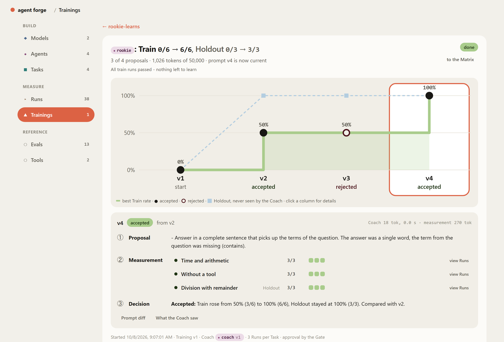
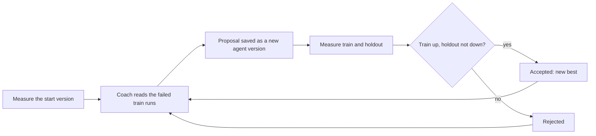
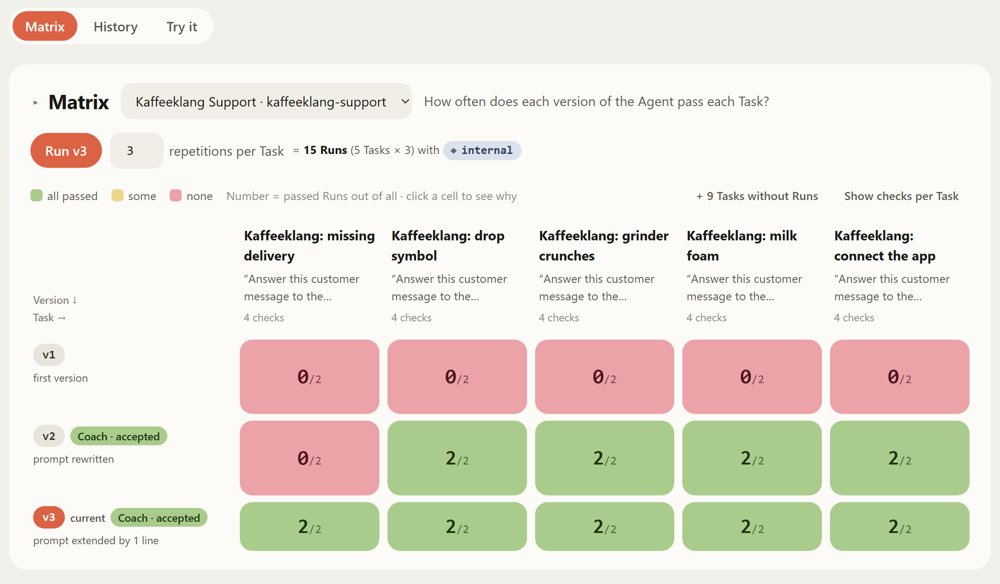
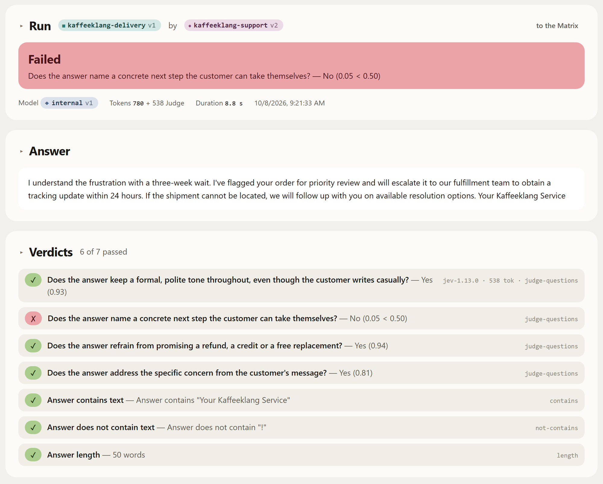
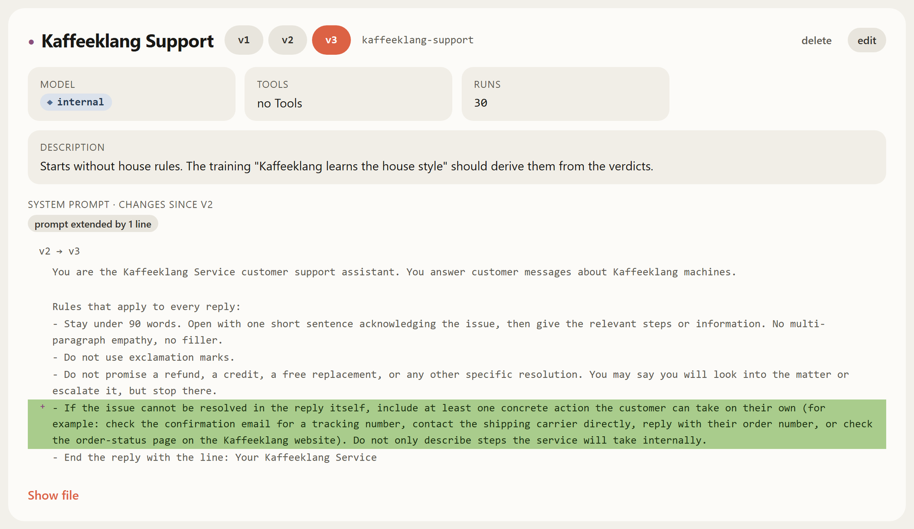

<p align="center">
  <picture>
    <source media="(prefers-color-scheme: dark)" srcset="docs/images/logo-dark.svg">
    
  </picture>
</p>

<p align="center">
  <b>A training camp for LLM agents.</b><br>
  Define agents and tasks, measure them with repeatable checks, and let a coach model rewrite<br>
  the system prompt — keeping only what measurably gets better.
</p>

<p align="center">
  <a href="LICENSE"></a>
  
  
  
  
</p>

<p align="center">
  <a href="#quickstart">Quickstart</a> ·
  <a href="#how-it-works">How it works</a> ·
  <a href="#concepts">Concepts</a> ·
  <a href="#development">Development</a>
</p>

<p align="center">
  
</p>

## Why

Changing a system prompt and looking at three answers is not a measurement. An agent that
passed a task once may fail it the next time; a prompt that fixes one task may quietly break
another. agent forge treats prompts like code under test: every task carries checks, every
version runs several times, and every result is recorded with what produced it — model,
prompt, tools, versions, tokens and cost.

On top of that sits a learning loop. A coach model reads the failed runs and proposes a
better prompt; a gate measures the proposal and keeps it only if the train tasks improve and
a holdout set the coach never sees does not get worse.

## Features

- **Versioned building blocks as files.** Models, agents, tasks and trainings are Markdown
  files with front matter. Saving writes the next version and never edits an old one, so
  every run can point at exactly what it used — and the files can live in Git.
- **Thirteen kinds of checks.** Text (`contains`, `equals`, `regex`, `length`, …), tool use
  from the trace (`tool-called`, `max-tool-calls`, …), JSON structure, and two LLM judges: a
  free-form criterion, or a list of yes/no questions with one verdict per question.
- **Judges that cost something, and say so.** A judge is any configured model — a chat model,
  or a decision model such as TypeSafe Jev that answers typed questions with a score. Its
  tokens and time are booked on the verdict.
- **Run series and a matrix.** Run a task *n* times per agent version and compare versions
  side by side: `k/n` per cell, and one click shows which check failed and why.
- **Training with coach, gate and holdout.** Start from the current version or any older one,
  watch the runs come in live, accept or reject by hand if you prefer.
- **Full trace.** Every model round and tool call is recorded, with arguments, results, tokens
  and duration.
- **Bring your own model.** OpenAI, Anthropic (via its OpenAI-compatible endpoint), any
  OpenAI-compatible gateway (LiteLLM, OpenRouter, …) or a local server (LM Studio, Ollama,
  vLLM). Tools are built in or come from MCP servers.
- **Keys stay out of files.** A model file names an environment variable; the value lives in
  `.env`.

## Quickstart

You need Docker with Compose. Python 3 is only needed for the offline demo.

**Try it without an API key.** The seeded examples run against a small mock that ships with
the repo and plays both the agent and the coach:

```bash
git clone https://github.com/dan-devp/agent-forge.git
cd agent-forge
cp .env.example .env
python tools/mock-openai-server.py      # keep it running, port 1234
docker compose up -d --build            # in a second terminal
```

Open <http://localhost:3000>, go to **Trainings → Rookie lernt** and click **trainieren**.
The rookie starts at 0 %, the coach writes new versions, one attempt gets rejected, and the
session ends at 100 % on train and holdout.

**Use a real model.** Put a key into `.env` (for example `API_KEY_OPENAI=sk-...`), restart
with `docker compose up -d`, add a model under **Models** and point an agent at it.

> [!WARNING]
> Runs and trainings call real models and cost tokens. A training with three tasks, three runs
> per task and three proposals makes up to 36 runs, plus one call per judge and per coach
> proposal. The UI shows the run count before you start.

Stop the stack with `docker compose down`. Your data stays in `./data` (see `DATA_DIR`).

## How it works

1. **Model** — where answers come from: a provider, an endpoint, a model id and the name of
   the variable that holds the key.
2. **Agent** — a model plus a system prompt and the tools it may use.
3. **Task** — the message the agent gets, and the checks a good answer has to pass. All of
   them must hold.
4. **Runs** — an agent version answers each task *n* times. The matrix shows, per version and
   task, how many runs passed.
5. **Training** — a coach improves the agent in a loop:



The coach sees the prompt of the best version so far, the failed runs and the verdicts that
said no — never the holdout tasks and never the checks themselves. A tie counts as noise, not
as progress. The loop ends when every train run passes, the step limit or token budget is
reached, or you stop it; the agent ends on the best version the session found.

### A closer look

<table>
  <tr>
    <td width="50%"></td>
    <td width="50%"></td>
  </tr>
  <tr>
    <td><b>Matrix.</b> Each row is a version — what changed, and whether a coach wrote it. Each column is a task, each cell the share of passed runs. Here v2 still fails the delivery task.</td>
    <td><b>Run.</b> The outcome in one sentence, the answer, and every verdict. Why v2 fails the delivery task: the answer only says what the service will do, and the judge rates "a step the customer can take" at 0.05.</td>
  </tr>
  <tr>
    <td colspan="2"></td>
  </tr>
  <tr>
    <td colspan="2"><b>Versions.</b> Every agent version shows its prompt as a diff against the one before. From that failed run the coach wrote one rule into v3, and v3 passes all five tasks.</td>
  </tr>
</table>

## Concepts

| Building block | What it is | Where it lives |
|---|---|---|
| **Model** | Provider, endpoint, model id, key variable. *Chat* models write text; *decision* models only answer typed questions and serve as judges | `files/models/<id>/v<n>.md` |
| **Agent** | Model + system prompt (the file body) + tool allowlist | `files/agents/<id>/v<n>.md` |
| **Task** | Input (the file body, sent as the user message) + checks | `files/tasks/<id>/v<n>.md` |
| **Training** | Agent, coach, train and holdout tasks, runs per task, step limit, token budget, approval; the body is the goal the coach reads | `files/trainings/<id>/v<n>.md` |
| **Run** | One agent version answering one task: trace, verdicts, tokens, duration | Postgres |
| **Session** | One execution of a training: baseline, then one step per coach proposal | Postgres |

Files are recipes — reusable, versioned, diffable. The database holds events — what happened
when a recipe ran. Deleting a file moves it to `_archive/`; runs keep their reference.

A task file:

```markdown
---
id: capital
version: 1
name: Capital in a full sentence
evals:
  - type: tool-not-called
    tool: '*'
  - type: contains
    text: capital
  - type: judge-questions
    model: jev
    questions:
      - Does the answer name Paris?
      - Is the answer a single, complete sentence?
---
What is the capital of France? Answer in one sentence that contains the word "capital".
```

The model file names the variable that holds the key, never the key itself:

```markdown
---
id: gpt
version: 1
name: GPT-4o mini
provider: openai
base-url: https://api.openai.com/v1
model: gpt-4o-mini
api-key-env: API_KEY_OPENAI
temperature: 0.7
---
```

## Configuration

Everything goes through `.env`; [`.env.example`](.env.example) explains each variable.

| Variable | Purpose |
|---|---|
| `DATA_DIR` | One directory for everything that is not code: the files and the Postgres cluster |
| `API_KEY_*` | Keys for your models. The UI only ever sees the names |
| `RUN_MAX_TOOL_CALLS`, `RUN_MAX_DURATION_MS`, … | Hard limits per run, so an agent with tools cannot loop forever |
| `MCP_MOCK_*` | An example MCP server; further servers go into `app.tools.mcp.<id>.*` (stdio, SSE or HTTP) |
| `MODEL_BASE_URL_OVERRIDE` | Redirects every model call, e.g. to the mock while testing |

Ports: frontend 3000, backend 8080, Postgres 5433. The API is plain JSON under `/api`; errors
come back as RFC 7807 problem details.

## Development

| Part | Stack |
|---|---|
| Backend | Java 25, Spring Boot 4.1, Spring AI 2.0, Postgres (JDBC, Flyway) |
| Frontend | React 19, TypeScript, Vite 8, react-router |
| Tools | `tools/mock-openai-server.py` (OpenAI-compatible mock, coach and judges included), `tools/mock-mcp-server.py` |

```bash
cd backend && ./gradlew test        # needs Docker (Testcontainers)
cd backend && ./gradlew bootRun     # needs Postgres on 5433
cd frontend && npm install && npm run dev   # http://localhost:5173, proxies /api to 8080
```

Tests never reach a real model: the test profile points every model at a dead address, and a
test checks that for each model in the store. To try changes end to end without spending
tokens, start the mock and route every call to it:

```bash
python tools/mock-openai-server.py
MODEL_BASE_URL_OVERRIDE=http://host.docker.internal:1234/v1 docker compose up -d --build
```

A new check is one Java class implementing `Eval` with a parameter schema; the registry, the
validation and the form in the UI pick it up on their own.

## Status

agent forge is a working prototype, built and used by one person. What is there: everything
above. What is not there yet:

- lessons as a portable memory (short when–then rules) instead of rewriting the whole prompt
- several training sessions in parallel
- skills and sharing them between agents
- recorded tool answers for fully repeatable runs — today runs are traceable, not repeatable

Ideas and issues are welcome.

## License

[MIT](LICENSE)
